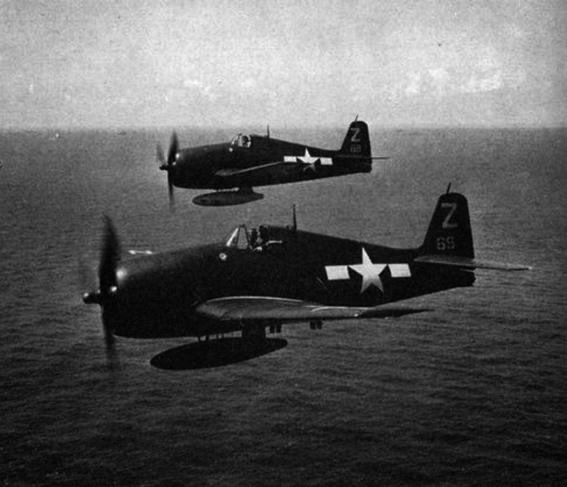

# Engineering wingman

*Two U.S. Navy F6F-5 Hellcats of Fighting Squadron 85 (USS Shangri-La), 1945. U.S. Navy photo, public domain, via [Wikimedia Commons](https://commons.wikimedia.org/wiki/File:Grumman_F6F-5_Hellcats_of_VF-85_in_flight,_in_1945.jpg).*

I describe myself as a software engineering "wingman" to better identify the "flavor" of engineering manager and TPM I show up as. Here's what I mean:

- You can count on me to cover or handle areas while you're focused on yours.
- I come alongside.
- I may not have all the vision, but I can support others in executing to get there.
- I'll stick with it through thick and thin.
- Even if it's not my idea, I'll show the care and ownership as if it is.
- I'll go the distance, and I'm happy to pioneer into new territory.
- I'm there for the journey and the camaraderie with others.

I'm not suggesting this is better or more effective than other forms of engineering leadership; it's just how I'm wired, what I value, and how I bring value to engineering teams and their leaders.
