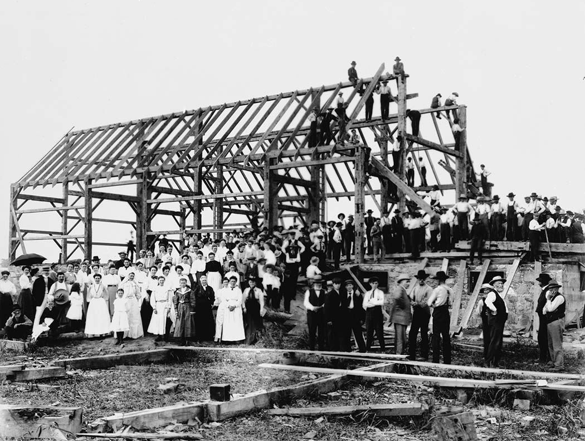

# Management philosophy

*Barn raising in Lansing (now North York), Toronto, around 1900. Photo by Alexander W. Galbraith, public domain, via [Wikimedia Commons](https://commons.wikimedia.org/wiki/File:Barn_raising_in_Lansing.jpg).*

Written in December 2020, near the end of my time at Amazon, and published here unchanged apart from typo fixes. An update reflecting Protocol Labs and FilOz is on my list.

## Purpose

While interviewing, I often got asked about my management philosophy. Below is an attempted first draft enumerating the key bits in my head. I’m sure others have said more and better things. This is what comes to mind when I’m not drawing from other resources. I can speak to examples for each item of why and how I have lived it out. 

## General

For just about anything you want to accomplish (whether revenue, innovative products), people are at the start of the equation. If you want to do something noteworthy or great, you need great people!

## My Style

Injecting humanity into software development has been one of the most consistent areas of praise I have received from my management, principal engineers, and people on my team. I care about relationships with people at work and outside of work as much as the work or product itself. If you're healthy and rested, you'll produce your best work. 

## The Culture I Create

1. Transparency - Except for items that are sensitive to an individual, I generally avoid emails that don't have a mailing list or chat direct messages. I don't expect everyone to track everything, but I want to ensure they have the ability to look into anything. I'll call out if specific people need to engage. Large groups can be inefficient though... 
2. Participation over attendance - I hate meetings where folks show up and are engaged on their laptop the whole time. I will set expectations around participation and make it clear that you don't get credit just for attending. I give team members permission not to attend so they can do what is best for them. If you're not required for the decisions being made in a meeting and aren't genuinely interested, you should leave. Others and I will think more highly of you if you do as it shows intentionality and that you value your time. 
3. Honesty - We always tell the truth, especially when things are bad (e.g., we're late, we missed something). Bad things and mistakes happen. Knowing about it early gives more/better chances to react. 
4. Direct and kind - I'm not going to be indirect or passive. For example, if I need extra time from the team to hit a key deliverable, I'll explicitly ask, I'll explain why I'm asking and why I think the situation warrants extra. I'll also discuss how we can compensate you for the extra time. I'll acknowledge your hard work and thank you. 
5. Ownership - Engineers should be measured and evaluated on things they can directly control. For example, I'm not a big fan of large QA or ops teams that engineers off load to. I believe engineers will produce better work if they feel the pain for cutting quality corners. It also completes the feedback cycle as you see how certain decisions affect you in production. I want teams to own their destiny. Part of ownership is giving teams autonomy in decision making within their area of ownership. I let teams determine the best return on investment for improving engineering efficiency or reducing operational load. 
6. Invest in yourself - It doesn't matter to me how, whether following thought leaders on Twitter, doing an online course, doing book clubs or learning series, but we all need to invest. It doesn't matter how busy we are, it's a non-negotiable. It's the way of making major steps as you realize a problem you're working on has already been solved or that there is something you can leverage. I view it like fishing. You can't control when exactly you're going to catch a fish, but the more hooks you have in the water, I believe the more likely you are to land one. 
7. Being clear about what done means - From individuals engineering tasks to products, it's important to be clear about what done means. When it's not articulated in written form, I see all kinds of issues like leaders thinking a project is further along than it actually is. 
8. Limit Work In Progress - Emphasize with engineers and teams that I'd rather get one thing fully done than 3 things half done. This is related to how adding lots of zeroes doesn't get you anything. You have to have some ones! 
9. Assume someone else will carry your work on - I by no means want this to happen, but whether because of personal taste to change teams/companies or personal emergency, we have to assume we'll all be gone at an unexpected time or the team that has to improve/change your work 6 months from now will not be the current team. I want whoever picks up my team's work to thank me for the state I left things in, not doing a git blame to curse me.

## Hiring

I'm risk averse when it comes to hiring. Mistakes here can have such a large impact, particularly for management positions.

Key things I'm looking for:

1. Where are they a superstar? What can they teach me about? I want to find people who are better than me in various dimensions. 
2. Is this person trustworthy? I'm looking for examples of how they earn trust. This is also highly correlated to: do they listen. 
3. Can they change their mind and adapt? What do they do with new data or failure?

Once you get people in, you have a retention problem. How do you keep people in? For me that happens in two primary ways:

1. Invest in people (develop them) 
2. Create an enticing and healthy culture and structure

## Developing

1. For junior engineers, it's really important that they be around role models that they can learn from or that I can point to. 
2. Identify if there are any growth inhibitors (language skills, communication, trust impediments), track those, see if there's any concrete proactive steps that they can take. 
3. Find out what people really want to do and look for ways that it intersects with the business. If someone says they want to be a manager, I break that down to the different components and look for ways for them to get their feet wet (manage an intern, be more involved in project planning). 
4. Expect folks to impart knowledge to others. Whether that is through mentoring, giving presentations, writing blog entries, leading a book club, etc. we learn a lot when we teach and lead.
